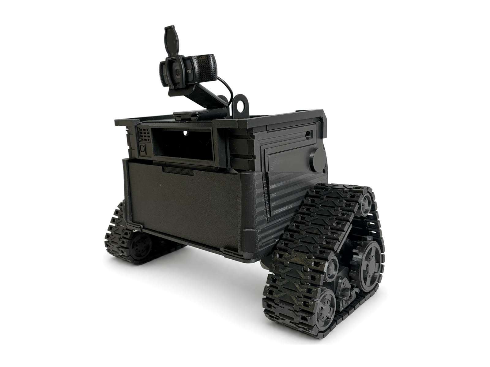
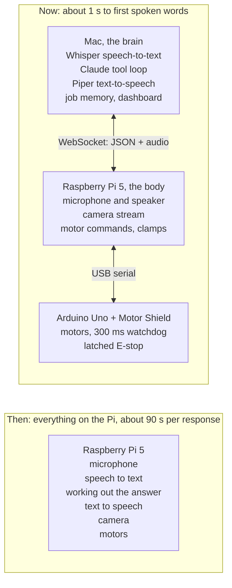
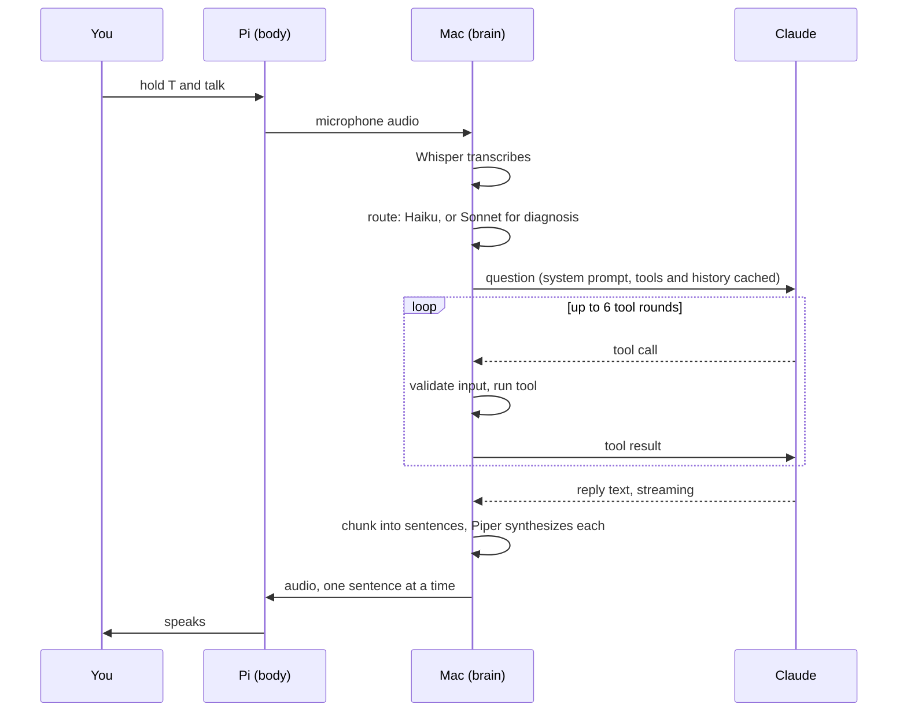
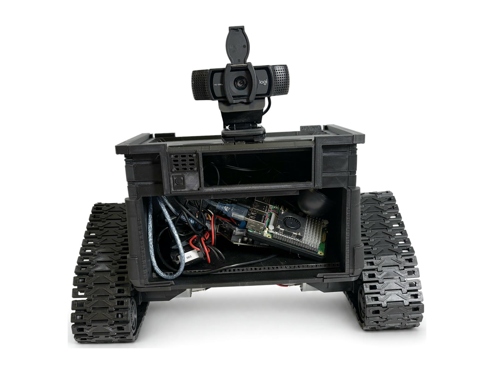

# TorQ

A tracked garage robot that listens, answers car-repair questions out loud with Claude, and keeps its safety logic off the network.



You ask it a question while your hands are on a wrench ("what's the lug nut torque on my Civic?") and it answers through a speaker. It remembers which vehicle you are working on, keeps job notes, and can be driven from a browser dashboard.

## Team

| Who | What |
|---|---|
| Diya and Spatika | The first version of the software, with everything running on the Raspberry Pi |
| Zach | The whole enclosure, printed in PLA |
| Atreyu | Electronics and wiring, drive firmware, and the current software in this repo |

## Then and now

The first version ran every process on the Raspberry Pi inside the robot. It proved the idea, but with everything on one small board a response took about 90 seconds.

The current software asks what actually has to be on the robot. The Pi keeps the jobs that touch hardware. The heavy work runs on a laptop on the same network. Stopping the motors lives on an Arduino, so it does not depend on either computer being healthy. On Claude Haiku the robot now starts speaking in about 1 second.



The reply is also streamed. TorQ speaks the first sentence while Claude is still writing the second, so the wait you feel is the time to the first sentence, not the whole answer.

## One question, start to finish



- **Routing.** Everyday questions go to Claude Haiku 5.5 at low effort. Questions containing diagnostic words such as "why", "noise", "leak" or "misfire" go to Claude Sonnet 5.5 at medium effort. The word list is in `config.yaml`.
- **Tools.** `get_vehicle_info`, `set_vehicle`, `save_note`, `stop`. Every input is validated in `brain/tools.py` before anything runs. A bad input goes back to the model as an error result.
- **Interruption.** A new question, or the Quiet button, cancels the answer in flight and the audio already queued on the robot.
- **Failures are spoken.** A bad key, a rate limit, no network, a refusal or a truncated tool call each map to a short sentence TorQ can say, so you are never left with silence.

### A real session

From the brain log, 13 November 2026:

| You asked | Model | Tools called | Time |
|---|---|---|---|
| "I'm working on a 2015 Honda Civic with the 1.8. What's the lug nut torque?" | Haiku | `set_vehicle`, `save_note` | 4.1 s |
| "It squeals for a few seconds on a cold start, then goes quiet. Why?" | Sonnet | none | 2.0 s |
| "Save a note that the serpentine belt needs replacing." | Haiku | `save_note` | 2.4 s |

Times are question to finished text, a sample from one session and not a benchmark.

## Safety

The model can stop the robot. It cannot drive it.

| Layer | Where | What it enforces |
|---|---|---|
| Firmware | Arduino | Motors stop if a drive command is not repeated within 300 ms. Latched E-stop. Overcurrent cutoff. Ramping and active braking. A hardware watchdog resets the board if the loop hangs. |
| Body | Raspberry Pi | Speed clamps and a command timeout, so a bad command from upstream cannot exceed them. |
| Brain and dashboard | Laptop | Hold-to-drive. Closing the tab stops the robot. An E-stop locks out driving until it is reset. |

## Hardware



Raspberry Pi 5, Arduino Uno R3 with Motor Shield Rev3, two 12 V gearmotors on tracks, Logitech C920 (camera and microphone), USB speaker, 3S battery pack, PLA enclosure.

## Repo layout

```
brain/      runs on the Mac
  server.py     dashboard and the WebSocket the Pi connects to
  claude.py     model routing, streaming, the tool loop
  tools.py      tool definitions and input validation
  voice.py      push-to-talk or typed text in, spoken answer out
  speech.py     Whisper, Piper, sentence chunking
  memory.py     vehicle and job notes
  dashboard/    camera view, chat, keyboard drive
body/       runs on the Pi
  main.py, link.py   service entry point and the link to the brain
  motors.py          clamps, trim, command timeout, serial to the Arduino
  audio_io.py        microphone capture and speaker playback
  telemetry.py       temperature, supply, Wi-Fi
  systemd/           torq-body and torq-camera services
firmware/torq_drive/  Arduino drive firmware
tests/      integration tests against a fake Arduino and stand-in models
config.yaml shared by brain and body
```

## Running it

```bash
# Brain, on the Mac
python3 -m venv .venv && .venv/bin/pip install -r requirements-dev.txt
echo "ANTHROPIC_API_KEY=sk-..." > .env        # never commit this
.venv/bin/python -m brain.server              # then open http://localhost:8000

# Body, deployed to the Pi over SSH (host "torq" by default)
scripts/deploy-body.sh

# Pi logs
ssh torq journalctl -fu torq-body
```

The first run downloads the Whisper model. The Piper voice goes in `data/voices/`. Flash `firmware/torq_drive/torq_drive.ino` to the Uno with the Arduino IDE.

Dashboard keys: `W` `A` `S` `D` or the arrow keys to drive (hold), `Space` to stop, `Esc` for E-stop, hold `T` to talk.

## Tests

```bash
.venv/bin/python -m pytest
```

20 integration tests. They run the real brain server and the real body code over real sockets, against a simulated Arduino that speaks the firmware's serial protocol, with stand-ins for Claude, Whisper and Piper. They cover the watchdog, E-stop lockout, tool validation, interruption and a missing API key.

## Not built yet

Cited service-manual lookup, a `take_photo` tool with vision, drive tools for Claude, a wake word, and status LEDs. See `TODO.md`.

The original goals document is kept at `_archive/torq-manual.md`.
