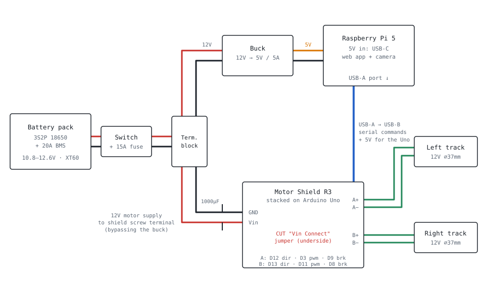

# TorQ — Drive Wiring

Raspberry Pi 5, Arduino Uno with Motor Shield R3, and the two 12V track motors.
Servos, PCA9685, screen and audio are left off this sheet.

| Wire colour | Meaning |
|---|---|
| Red | 12V battery + |
| Black | Ground |
| Orange | 5V |
| Blue | USB cable |
| Green | Motor leads |

The battery feeds two separate branches from one terminal block: the buck converter
makes 5V for the Pi, and the motor shield takes raw 12V for the tracks. The Pi only
talks to the Arduino over USB, and that cable also powers the Uno and ties the grounds
together.

---

## Do we need the Arduino?

**No, the Pi can drive the motors on its own. Keep the Arduino anyway.** On a 12-week
clock it saves more time than the $12 it costs.

**Why keep it**
- Chillibasket's code is already split this way: the Pi's web app sends serial
  commands, and the Arduino sketch drives the motors and servos. Dropping the Uno
  means rewriting the motion code.
- The Motor Shield plugs straight onto the Uno. No signal wiring.
- The Arduino keeps running if the Pi freezes, and the status OLED in the chest
  hangs off it.

**What dropping it looks like**
- Swap the shield for a standalone driver (TB6612 or L298N) wired to 6 Pi GPIO pins.
  Pi 3.3V logic is fine for both.
- The PCA9685 servo board connects straight to the Pi over I²C.
- Saves about $25 and one USB cable. Costs a motion-code rewrite plus your own
  "stop if commands stop" timeout.

---

## Pin map

| Shield terminal | Goes to | Uno pins it uses |
|---|---|---|
| `Vin` / `GND` | Terminal block, 12V + and − | None, once the jumper is cut |
| `A+` / `A−` | Left track motor | D12 dir · D3 pwm · D9 brake · A0 current |
| `B+` / `B−` | Right track motor | D13 dir · D11 pwm · D8 brake · A1 current |
| USB-B (Uno) | Pi 5 USB-A port | Serial + 5V |

---

## How this differs from chillibasket's diagram

- **Motors are the same.** His diagram also runs battery 12V straight to the shield's
  screw terminal, puts the right motor on B and the left motor on A.
- **His buck converter powers the servos and the Uno's 5V pin.** His diagram leaves
  out the Pi. Ours has the Pi on a 5V/5A rail and the servos on their own 6V rail,
  per the dual-rail swap in [BOM.md](BOM.md).
- **He doesn't cut the Vin Connect jumper**, so the pack also feeds the Uno's Vin
  while his buck feeds its 5V pin. That puts two supplies on one rail. We cut the
  jumper and power the Uno from the Pi's USB only, so **skip his red wire to the
  Uno's 5V pin.**

---

## Before first power-up

1. **Cut the "Vin Connect" jumper** on the back of the Motor Shield. Arduino says to
   do this for any motor supply above 9V. A full pack is 12.6V, and you don't want
   that on the Uno's Vin. The Uno runs off the Pi's USB instead.
2. **Common ground comes free through the USB cable.** Don't add another ground wire
   between the Pi and the Uno; that creates a loop.
3. **Put a 1000µF capacitor, 25V or higher, across the shield's screw terminals** so
   motor starts don't brown out the rest of the robot. Mind the polarity.
4. **Test with the tracks off the ground.** If one track runs backwards, swap that
   motor's two leads, or flip it in the code. The motors are mirrored, so expect this
   on one side.
5. **Expect cut-outs on a hard stall.** The shield's L298 chip is rated 2A per
   channel. If a track jams, the chip shuts itself off to cool down instead of
   burning. It also drops about 2V, so the motors see roughly 10V.

Interactive version: https://claude.ai/artifact/PpmqApn1sfFUd98PkSB4EZ (private —
share it from the page's Share menu before sending the link to the group).
